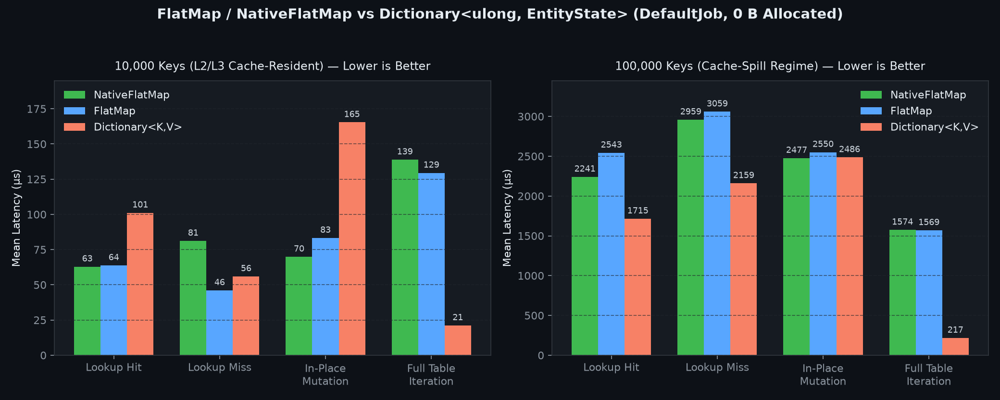

# ZeroAlloc.Memory

[](https://github.com/Markism-JA/ZeroAlloc.Memory/actions/workflows/ci.yml)
[](https://www.nuget.org/packages/ZeroAlloc.Memory)
[](./LICENSE)

Zero-allocation unmanaged memory allocators, linear arenas, virtual-memory mirrored ring buffers, and native collections for .NET 10 and `netstandard2.1` (Unity / client / server).

Compiled as `AnyCPU` and tested in CI across 64-bit `x64` and `ARM64` (`linux-x64`, `linux-arm64`, `win-x64`, `osx-arm64`).

---

## Origin & Intent

`ZeroAlloc.Memory` was originally built as the memory and IPC foundation for a high-tickrate distributed game/simulation engine (*Echoes of Bathala*) where:

* Gen0/Gen2 GC pauses in hot simulation and networking loops were unacceptable,
* Variable-length ring buffers needed contiguous `Span<byte>` reads/writes across wrap-around boundaries without split copies, and
* A single memory foundation had to run identically across .NET 10 Linux servers (`x64`/`ARM64`) and `netstandard2.1` Unity clients.

---

## Installation

```bash
dotnet add package ZeroAlloc.Memory
```

---

## When to Use (and When NOT to Use)

| Use `ZeroAlloc.Memory` When… | Do NOT Use When… |
| :--- | :--- |
| Standard `ArrayPool<T>`, `Dictionary<K,V>`, or `Channel<T>` causes measurable GC pauses in hot loops. | Standard .NET BCL collections already meet your latency budget. |
| You store `unmanaged` structs or raw byte frames with deterministic tick/frame lifetimes. | You need to store managed reference types (`class`, `string`). |
| You have strictly 1P/1C (`SpscRing`, `MirroredSpscRing`) or NP/1C (`BoundedMpscRing`, `MirroredMpscRing`) thread topologies. | You have multiple concurrent consumers (MPMC is intentionally excluded). |

See the full [Collections & Arenas Decision Guide](./docs/collections-guide.md) and [Architecture & Memory Model](./docs/architecture.md).

---

## Safety Contract & Known Limitations

1. 64-bit process required: Built as `AnyCPU` for `x64` and `ARM64` portability; 32-bit processes (`x86`/`arm32`) are unsupported and throw `PlatformNotSupportedException` in `PageAllocator`.
2. Manual lifetime (`IDisposable`): Value-type native handles and wrappers do not rely on GC finalizers for hot-path cleanup. Failing to call `Dispose()` leaks unmanaged/virtual memory.
3. Thread-topology guarantees: `SpscRing` and `MirroredSpscRing` are strictly Single-Producer / Single-Consumer. Calling `TryEnqueue`/`TryWrite` from multiple threads requires `BoundedMpscRing` or `MirroredMpscRing`.
4. Debug vs. Release guards: `UnmanagedPage` / `DebugMemoryGuard` trailing canaries (`0xDEADBEEF`) catch buffer overruns in `Debug` builds and compile out to zero overhead in `Release`.

---

## Quick Start

```csharp
using Memory.Arena;
using Memory.Collections.Spsc;

// 1. Frame/tick-scoped linear arena (0 GC allocations)
using var arena = new UnmanagedLinearArena(capacityBytes: 64 * 1024);
int* buffer = arena.Allocate<int>(128);
buffer[0] = 42;

// 2. Cache-padded SPSC ring buffer (strictly 1 producer, 1 consumer)
using var ring = new SpscRing<long>(capacity: 1024);
ring.TryEnqueue(123456L);
ring.TryDequeue(out long value);
```

---

## Benchmarks (`.NET 10 X64`, `0 B` Managed Allocation)



* `SpscRing` (`64 B` round-trip): `5.68 ns`, `0 B` allocated (15.4× faster than bounded `Channel<T>` at `87.28 ns`).
* `BoundedMpscRing` vs `Channel<T>` (`64 B` round-trip): `13.52 ns` vs `87.28 ns` (6.46× faster uncontended; `78.41 µs` vs `126.46 µs` under 4-producer contention, `0 B` allocated).
* `MirroredSpscRing` (`64 B` packet round-trip): `9.41 ns` (managed) / `9.67 ns` (native), `0 B` allocated.
* `FlatMap` / `NativeFlatMap` vs `Dictionary<K,V>` (`10,000` keys): `62.89 µs` vs `101.16 µs` on hits (1.61× faster), `69.89 µs` vs `165.39 µs` on in-place mutation (2.37× faster), `0 B` allocated. *(Note: `Dictionary` is faster on `100,000`-key point lookups and dense full-table iteration — see full analysis.)*
* `UnmanagedLinearArena` (`10,000` batch slices): `1,278.1 ns` (`0.13 ns/item`, `0 B` allocated).

Full BenchmarkDotNet tables, charts & analysis (all 17 suites): [docs/benchmarks/README.md](./docs/benchmarks/README.md)

---

## Building, Testing & Benchmarking

```bash
# Run full unit & concurrency stress suite (223 tests)
dotnet test -c Release

# Verify netstandard2.1 compatibility
dotnet build src/Memory/Memory.csproj -c Release -f netstandard2.1

# Run BenchmarkDotNet suite
dotnet run --project benchmark/Memory.Benchmark -c Release -- --filter *
```

---

## License

[MIT](./LICENSE) © 2026 Markism-JA
