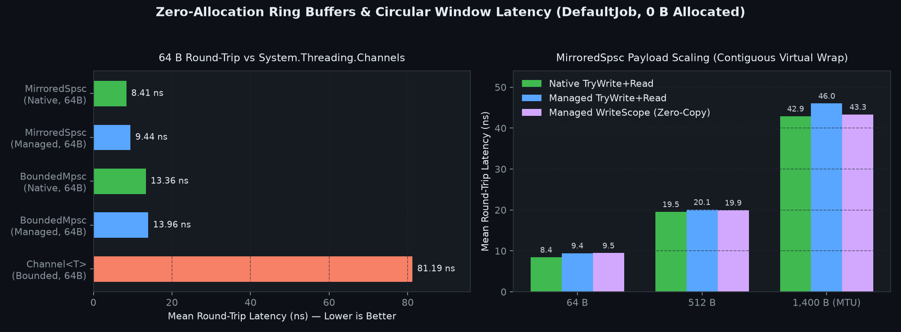

# Benchmark Results & Performance Analysis

Measured with **BenchmarkDotNet v0.15.8** on **Linux (Arch Linux)**, `11th Gen Intel Core i3-1115G4` (base 3.00 GHz, turbo disabled / capped at `1.59 GHz` via `bench-setup.sh`), `.NET 10.0.2 (X64 RyuJIT x86-64-v4)`, `[MemoryDiagnoser]`.

Reproduce locally:

```bash
dotnet run --project benchmark/Memory.Benchmark -c Release -- --filter "*"
```

### How to Read These Numbers
* **`DefaultJob` suites** (`FlatMapBenchmark`, `VirtualMapBenchmark`, `MonotonicTableBenchmark`, `BoundedMpscRingBenchmark`, `MirroredSpscBenchmark`) use `[GlobalSetup]` so BenchmarkDotNet auto-scales invocation counts for sub-microsecond accuracy.
* **Destructive `[IterationSetup]` suites** (`FlatMapRemovalBenchmark`, `VirtualMapRemovalBenchmark`) run with `InvocationCount=1` so each iteration starts from a freshly populated table.
* **Legacy `ShortRunJob` suites** (`SpscRing`, `MirroredMpsc`, `CircularWindow`, `Arena`, `Layout`, `Allocators`) reflect `IterationCount=3, WarmupCount=3`. Single-shot multi-threaded or OS-paging operations (`Mpsc_Concurrent_Drain_*`, `Parallel_MultiThreaded_Lease_Contention`, `Commit_Decommit_Loop`) include thread-wakeup or kernel-syscall overhead rather than pure per-item cost.

---

## 1. Associative Maps (`FlatMap`, `VirtualMap`, `MonotonicTable`)


### Why It Behaves This Way
1. **L2/L3-Resident Working Sets (`10,000` keys):** `NativeFlatMap` (`62.89 µs`) and `FlatMap` (`63.78 µs`) beat `Dictionary<K,V>` (`101.16 µs`) by **~1.6×** on lookup hits and **~2.4×** on in-place struct mutation (`69.89 µs` vs `165.39 µs`). Open-addressed inline slots avoid pointer chasing (`_buckets` → `_entries`) and `GetValueRefOrAddDefault` returns a direct `ref TValue` so callers mutate fields in place instead of copying a `28 B` struct out and back.
2. **Cache-Spill Regime (`100,000` keys):** Once the open-addressed table exceeds CPU cache on this 2-core i3, `Dictionary<K,V>` (`1,715.20 µs`) overtakes `NativeFlatMap` (`2,241.07 µs`) on pure point lookups. `FlatMap` stores `[State + Key + Value]` inline per slot, so probe chains touch larger cache footprints per step than `Dictionary`'s compact `int[] _buckets` indirection.
3. **Dense Iteration Trade-Off:** `Dictionary` iterates a densely packed `_entries` array (`217.18 µs` at `100,000` keys), whereas open-addressed tables (`FlatMap`, `VirtualMap`) must scan every capacity slot including empty gaps (`1,574.32 µs`).
4. **Managed Wrapper (`FlatMap`) vs Raw Pointer (`NativeFlatMap`):** With `[GlobalSetup]` auto-scaling, `FlatMap` (`63.78 µs`) and `NativeFlatMap` (`62.89 µs`) match within ~1% — the managed RAII wrapper adds virtually zero lookup overhead while guaranteeing safe `Dispose()`.
5. **When to Choose `FlatMap` / `VirtualMap` / `Monotonic*`:** Choose them when **0 B managed allocation**, **deterministic unmanaged/virtual lifetime** (`VirtualMap.PassiveDecommitReclaim`), **`ref` in-place mutation**, or **sequence-dominated monotonic upserts** (`MonotonicFlatMap` / `MonotonicVirtualMap`) matter more than 100k+ dense-iteration speed.

### 1.1 `FlatMap` & `NativeFlatMap` vs `Dictionary<ulong, EntityState>` (`DefaultJob`)

| Method | `10,000` Keys Mean | `10,000` Ratio | `100,000` Keys Mean | `100,000` Ratio | Allocated |
| :--- | ---: | ---: | ---: | ---: | ---: |
| `Lookup_Hit_FlatMap` | 63.78 µs | 1.00 | 2,542.80 µs | 1.01 | 0 B |
| `Lookup_Hit_NativeFlatMap` | **62.89 µs** | **0.99** | 2,241.07 µs | 0.89 | 0 B |
| `Lookup_Hit_ManagedDictionary` | 101.16 µs | 1.59 | **1,715.20 µs** | **0.68** | 0 B |
| `Lookup_Miss_FlatMap` | **46.04 µs** | **0.72** | 3,059.30 µs | 1.21 | 0 B |
| `Lookup_Miss_NativeFlatMap` | 81.18 µs | 1.27 | 2,958.99 µs | 1.17 | 0 B |
| `Lookup_Miss_ManagedDictionary` | 55.95 µs | 0.88 | **2,159.44 µs** | **0.85** | 0 B |
| `InPlace_Mutation_FlatMap` | 83.28 µs | 1.31 | 2,550.50 µs | 1.01 | 0 B |
| `InPlace_Mutation_NativeFlatMap` | **69.89 µs** | **1.10** | **2,476.60 µs** | **0.98** | 0 B |
| `InPlace_Mutation_ManagedDictionary` | 165.39 µs | 2.59 | 2,485.88 µs | 0.98 | 0 B |
| `Full_Table_Iteration_FlatMap` | 129.47 µs | 2.03 | 1,569.24 µs | 0.62 | 0 B |
| `Full_Table_Iteration_NativeFlatMap` | 138.86 µs | 2.18 | 1,574.32 µs | 0.62 | 0 B |
| `Full_Table_Iteration_ManagedDictionary` | **21.15 µs** | **0.33** | **217.18 µs** | **0.09** | 0 B |

### 1.2 `FlatMapRemovalBenchmark` (`InvocationCount=1`, `[IterationSetup]`)

Backward-shift deletion keeps probe chains compact without tombstones (preserving miss-lookup speed), at the cost of shifting subsequent entries compared to `Dictionary`'s free-list unlink:

| Method | `10,000` Keys Mean | `100,000` Keys Mean | Allocated |
| :--- | ---: | ---: | ---: |
| `BackwardShift_Removal_FlatMap` | 260.1 µs | 2,651.7 µs | 0 B |
| `BackwardShift_Removal_NativeFlatMap` | 251.2 µs | 2,622.3 µs | 0 B |
| `Removal_ManagedDictionary` | **192.1 µs** | **1,506.7 µs** | 0 B |

### 1.3 `VirtualMap` & `NativeVirtualMap` vs `FlatMap` & `Dictionary` (`DefaultJob`)

`VirtualMap` matches `FlatMap` throughput almost identically (`64.72 µs` vs `62.99 µs` at `10,000` keys) while backing its table with OS virtual memory so sparse/shrunk regions can be decommitted via `PassiveDecommitReclaim()`:

| Method | `10,000` Keys Mean | `100,000` Keys Mean | Allocated |
| :--- | ---: | ---: | ---: |
| `Lookup_Hit_VirtualMap` | 64.72 µs | 2,245.58 µs | 0 B |
| `Lookup_Hit_NativeVirtualMap` | 63.65 µs | 2,169.51 µs | 0 B |
| `Lookup_Hit_FlatMap` | **62.99 µs** | 2,231.33 µs | 0 B |
| `Lookup_Hit_NativeFlatMap` | 63.46 µs | 2,201.63 µs | 0 B |
| `Lookup_Hit_ManagedDictionary` | 100.48 µs | **1,779.87 µs** | 0 B |
| `Lookup_Miss_VirtualMap` | 105.00 µs | 3,061.22 µs | 0 B |
| `Lookup_Miss_NativeVirtualMap` | 82.03 µs | 3,009.68 µs | 0 B |
| `Lookup_Miss_FlatMap` | **44.88 µs** | 2,964.74 µs | 0 B |
| `Lookup_Miss_NativeFlatMap` | 80.55 µs | 2,962.35 µs | 0 B |
| `Lookup_Miss_ManagedDictionary` | 135.66 µs | **2,161.88 µs** | 0 B |
| `InPlace_Mutation_VirtualMap` | 80.34 µs | 2,759.36 µs | 0 B |
| `InPlace_Mutation_NativeVirtualMap` | 77.29 µs | 2,699.24 µs | 0 B |
| `InPlace_Mutation_FlatMap` | 75.81 µs | 2,571.71 µs | 0 B |
| `InPlace_Mutation_NativeFlatMap` | **68.81 µs** | **2,459.88 µs** | 0 B |
| `InPlace_Mutation_ManagedDictionary` | 164.62 µs | 2,505.67 µs | 0 B |
| `Full_Table_Iteration_VirtualMap` | 129.07 µs | 1,562.99 µs | 0 B |
| `Full_Table_Iteration_NativeVirtualMap` | 139.16 µs | 1,575.34 µs | 0 B |
| `Full_Table_Iteration_FlatMap` | 129.38 µs | 1,566.36 µs | 0 B |
| `Full_Table_Iteration_ManagedDictionary` | **19.82 µs** | **215.27 µs** | 0 B |

### 1.4 `VirtualMapRemovalBenchmark` (`InvocationCount=1`, `[IterationSetup]`)

| Method | `10,000` Keys Mean | `100,000` Keys Mean | Allocated |
| :--- | ---: | ---: | ---: |
| `BackwardShift_Removal_VirtualMap` | 278.5 µs | 2,689.9 µs | 0 B |
| `BackwardShift_Removal_NativeVirtualMap` | 250.7 µs | 2,641.1 µs | 0 B |
| `BackwardShift_Removal_FlatMap` | 270.1 µs | 2,662.4 µs | 0 B |
| `Removal_ManagedDictionary` | **184.5 µs** | **1,611.0 µs** | 0 B |

### 1.5 `MonotonicTableBenchmark` (`MonotonicFlatMap` & `MonotonicVirtualMap`, `DefaultJob`)

Adding per-entry `ulong` sequence dominance checks adds ~1–4 µs across `10,000` lookups (`63.76 µs` vs `62.89 µs`) and rejects out-of-order stale updates (`Stale`) even faster than advancing writes (`80.57 µs` vs `86.42 µs`) because no payload write occurs:

| Method | `10,000` Keys Mean | `100,000` Keys Mean | Allocated |
| :--- | ---: | ---: | ---: |
| `Lookup_Hit_MonotonicFlatMap` | 67.41 µs | 2,496.62 µs | 0 B |
| `Lookup_Hit_NativeMonotonicFlatMap` | **63.76 µs** | 2,336.36 µs | 0 B |
| `Lookup_Hit_MonotonicVirtualMap` | 70.57 µs | 2,446.61 µs | 0 B |
| `Lookup_Hit_NativeMonotonicVirtualMap` | 66.44 µs | 2,369.05 µs | 0 B |
| `Lookup_Hit_ManagedDictionary` | 100.74 µs | **1,797.01 µs** | 0 B |
| `TryPut_NewerSequence_MonotonicFlatMap` | 86.42 µs | 3,041.41 µs | 0 B |
| `TryPut_StaleSequence_Rejected_MonotonicFlatMap` | 80.57 µs | 2,651.61 µs | 0 B |
| `TryPut_NewerSequence_MonotonicVirtualMap` | 89.95 µs | 3,230.86 µs | 0 B |
| `TryPut_StaleSequence_Rejected_MonotonicVirtualMap` | 82.45 µs | 2,868.72 µs | 0 B |

---

## 2. Ring Buffers & Circular Windows



### Why It Behaves This Way
1. **Lock-Free Fixed Rings vs `Channel<T>`:** `NativeBoundedMpscRing` completes a `64 B` round-trip in **`13.36 ns`** (`13.96 ns` managed) compared to **`81.19 ns`** for bounded `System.Threading.Channels.Channel<T>` (**6.08× faster**). Pre-allocated unmanaged slots, cache-line padded sequence counters (`PaddedSequence`), and zero async/continuation machinery eliminate synchronization overhead on hot paths.
2. **Virtual-Memory Double Mapping (`MirroredSpscRing` / `MirroredMpscRing`):** Because the underlying buffer is mapped twice back-to-back in virtual address space, variable-length frames (`64 B`, `512 B`, `1400 B` MTU) never split across the wrap-around boundary. `MirroredSpscRing` scales linearly with `memcpy` bandwidth (`8.41 ns` → `19.54 ns` → `42.91 ns`), and `SpscWriteScope` gives RAII zero-copy writes at virtually the same speed (`9.46 ns` at `64 B`).
3. **Seqlock `CircularWindow`:** Overwrites the oldest slot with lock-free per-slot sequence counters (`6.95 ns` append, `0.38 ns` tail inspection), ideal for rolling telemetry/history windows where readers tolerate retry on concurrent wrap.

### 2.1 `BoundedMpscRingBenchmark` vs `Channel<T>` (`DefaultJob`, 64B struct)

| Method | Mean | Ratio | Allocated |
| :--- | ---: | ---: | ---: |
| `Managed_Single_RoundTrip` | 13.96 ns | 1.00 | 0 B |
| `Native_DirectPointer_RoundTrip` | **13.36 ns** | **0.96** | **0 B** |
| `Channel_TryWrite_TryRead_RoundTrip` | 81.19 ns | 5.82 | 0 B |
| `Batch_Write_And_Drain` (`64` items) | 1,074.65 ns | 77.03 | 0 B |

### 2.2 `MirroredSpscBenchmark` (`DefaultJob`, virtual-memory mirrored ring)

| Method | `64 B` Mean | `512 B` Mean | `1,400 B` Mean | Allocated |
| :--- | ---: | ---: | ---: | ---: |
| `Managed_Single_Packet_RoundTrip` | 9.442 ns | 20.079 ns | 46.025 ns | 0 B |
| `Native_Single_Packet_RoundTrip` | **8.412 ns** | 19.542 ns | **42.908 ns** | 0 B |
| `Managed_WriteScope_ZeroCopy_RoundTrip` | 9.455 ns | 19.926 ns | 43.330 ns | 0 B |
| `Native_ReserveCommit_ZeroCopy_RoundTrip` | 8.532 ns | **18.957 ns** | 45.364 ns | 0 B |
| `Batch_Write_And_Drain` (`32` packets) | 315.475 ns | 675.270 ns | 1,481.972 ns | 0 B |

### 2.3 `CircularWindowBenchmarks` (`ShortRunJob`)

| Method | Mean | Allocated |
| :--- | ---: | ---: |
| `Native: Append Single (Per-slot seqlock write)` | **6.95 ns** | 0 B |
| `Native: AppendBatch 32 (Contiguous burst write)` | 251.44 ns | 0 B |
| `Static IPC: AppendRaw 32 (Direct Partition Slots & Cursor)` | **90.35 ns** | 0 B |
| `Native: ReadLatest 32 (Reverse-scan + Seqlock check)` | 439.99 ns | 0 B |
| `Managed: ReadLatest Span 32 (Safe Span Facade)` | 445.23 ns | 0 B |
| `Native: QueryFiltered (C-ABI Function Pointer + Terminal Cutoff)` | 953.97 ns | 0 B |
| `Zero-Copy: Tail Slot Inspection` | **0.38 ns** | 0 B |

### 2.4 `SpscRingBenchmark` (`ShortRunJob`, `InvocationCount=1`)

Bulk `Enqueue`/`Drain` (`854.7 ns` for `64` items ≈ `13.4 ns/item`) amortizes memory barriers ~3.2× over scalar per-item `TryEnqueue` (`2,732.3 ns`):

| Method | Mean | Median | Allocated |
| :--- | ---: | ---: | ---: |
| `RoundTrip_Copy_64B` | 131.2 ns | 112.5 ns | 0 B |
| `RoundTrip_Copy_512B` | 449.8 ns | 494.5 ns | 0 B |
| `RoundTrip_ZeroCopyPointer_64B` | 205.5 ns | 176.5 ns | 0 B |
| `RoundTrip_ZeroCopyPointer_512B` | 1,234.2 ns | 985.5 ns | 0 B |
| `Batch_ScalarEnqueue_And_Drain_64B` (`64` items) | 2,732.3 ns | 2,435.0 ns | 0 B |
| `Batch_BulkEnqueue_And_Drain_64B` (`64` items) | **854.7 ns** | **731.0 ns** | 0 B |
| `Concurrent_Thread_Pipeline_Throughput_Copy` (`100k` items) | 1,049.7 µs | 1,035.9 µs | 0 B |
| `Concurrent_Thread_Pipeline_Throughput_ZeroCopyPointer` (`100k` items) | 4,629.4 µs | 4,591.5 µs | 0 B |

### 2.5 `MirroredMpscBenchmark` (`ShortRunJob`, `InvocationCount=1`)

| Method | `64 B` Median | `512 B` Median | `1,400 B` Median | Allocated |
| :--- | ---: | ---: | ---: | ---: |
| `Managed_Single_Packet_RoundTrip` | 359.0 ns | 550.5 ns | 586.5 ns | 0 B |
| `Native_DirectPointer_Single_Packet_RoundTrip` | 429.5 ns | 644.5 ns | 789.0 ns | 0 B |
| `Burst_Drain_Managed_DrainBatch_32Packets` | 8,213.5 ns | 10,422.5 ns | 25,973.0 ns | 0 B |
| `Burst_Drain_Native_DrainBatch_32Packets` | 8,631.5 ns | 10,868.5 ns | 21,858.0 ns | 0 B |
| `Mpsc_Concurrent_Drain_1By1` (`4` producers) | 182.1 µs | 418.3 µs | 477.6 µs | 2,120–2,376 B |
| `Mpsc_Concurrent_Drain_Batch_Devirtualized` (`4` producers) | 212.9 µs | 458.1 µs | 274.1 µs | 2,216–2,504 B |

*(Concurrent MPSC benchmarks allocate ~2 KB once per iteration for `Task.Run` orchestration inside the benchmark harness, not inside `MirroredMpscRing`.)*

---

## 3. Arenas & Page Layouts (`ShortRunJob`)

### Why It Behaves This Way
* **Batch vs Individual Arena Leases:** `UnmanagedLinearArena.Lease_Batch_Slices` carves `10,000` contiguous slices in **`2,835.7 ns`** (`0.28 ns/item`) vs `154.7 µs` for individual atomic/disposed lease cycles.
* **Dirty vs Zeroed Carving:** `Carve` (dirty) is a pure pointer bump (`~12–18 µs` for 1,000 slices regardless of slice size), whereas `CarveZeroed` scales linearly with total bytes zeroed (`33.2 µs` at `32 B` → `155.2 µs` at `512 B`). Prefer dirty `Carve` whenever you immediately overwrite the buffer.
* **Pre-Committed vs Demand-Commit Pages:** `UnmanagedVirtualPage` pre-committed fast paths match `UnmanagedPage` (`~10–14 µs` for 500 carves), while first-touch demand commit (`Carve_With_DemandCommit_Kernel_Pass`) pays the OS page-fault/commit cost once per new page (`378.6 µs` across 500 × 4 KiB pages).

### 3.1 `UnmanagedLinearArenaBenchmark` (`InvocationCount=1`)

| Method | `100` Leases | `1,000` Leases | `10,000` Leases | Allocated |
| :--- | ---: | ---: | ---: | ---: |
| `Lease_Batch_Slices` | **432.3 ns** | **1,022.5 ns** | **2,835.7 ns** | 0 B |
| `Lease_SingleThreaded_Cycle` | 2,672.8 ns | 28,082.2 ns | 154,666.7 ns | 0 B |
| `Lease_And_TrimBackingMemory` | 7,109.8 ns | 3,448.2 ns | 4,453.2 ns | 0 B |
| `Parallel_MultiThreaded_Lease_Contention` | 67.1 µs | 97.2 µs | 866.3 µs | 1.9–2.5 KB |

### 3.2 `UnmanagedArrayTrackBenchmark`

| Method | `1,000` Elements | `10,000` Elements | `100,000` Elements | Allocated |
| :--- | ---: | ---: | ---: | ---: |
| `Sequential_Read_Sum` | 1.493 µs | 17.827 µs | 136.464 µs | 0 B |
| `Sequential_Write_Mutate` | 1.609 µs | 16.577 µs | 146.981 µs | 0 B |
| `Random_Access_Read_Sum` | 1.385 µs | 13.746 µs | 135.248 µs | 0 B |

### 3.3 `UnmanagedPageBenchmark` (`1,000` carves)

| SliceSize / Alignment | `Carve_Dirty_Sequential_1000` | `CarveZeroed_Sequential_1000` | `Carve_And_Write_Payload_1000` | Allocated |
| :--- | ---: | ---: | ---: | ---: |
| `32 B` / `16 B` | 12.40 µs | 33.17 µs | 15.28 µs | 0 B |
| `128 B` / `64 B` | 15.28 µs | 51.79 µs | 18.45 µs | 0 B |
| `512 B` / `64 B` | 18.53 µs | 155.16 µs | 50.32 µs | 0 B |

### 3.4 `UnmanagedVirtualPageBenchmark` (`500` carves)

| SliceSize / VirtualCapacity | `Carve_PreCommitted_FastPath_500` | `CarveZeroed_PreCommitted_FastPath_500` | `Carve_With_DemandCommit_Kernel_Pass` | Allocated |
| :--- | ---: | ---: | ---: | ---: |
| `64 B` / `2 MiB` | 10.26 µs | 23.38 µs | 27.60 µs | 0 B |
| `512 B` / `16 MiB` | 14.64 µs | 65.72 µs | 64.03 µs | 0 B |
| `4096 B` / `16 MiB` | 11.08 µs | 438.72 µs | 378.62 µs | 0 B |

---

## 4. Allocators (`ShortRunJob`)

* **`HeapAllocator`** (`13.53 ns` for `64 B` align-16) matches `NativeMemory.AlignedAlloc` (`13.98 ns`) while remaining portable across `netstandard2.1` (via its OS-direct fallback at `21.67 ns`).
* **`PageAllocator`** virtual reserve/release takes `~1.4–1.8 µs` regardless of reserved span size (`1` to `256` pages), while touching all physical pages (`256` pages = `1 MiB`) takes `264.34 µs` due to kernel zero-fill page faults.
* **`AllocatorMirroredRingBenchmark`** shows that once a mirrored ring buffer is mapped (`~6.9 µs` setup), reading across the virtual wrap boundary runs at raw memory speed (**`4.57 ns`**).

### 4.1 `NativeHeapAllocatorBenchmark` (`64 B` & `4096 B` alloc+free)

| Method | `64 B` (`Align 16`) | `64 B` (`Align 64`) | `4096 B` (`Align 16`) | `4096 B` (`Align 64`) | Allocated |
| :--- | ---: | ---: | ---: | ---: | ---: |
| `NativeMemory_AlignedAlloc_Free` | 13.98 ns | 15.06 ns | 50.88 ns | 95.39 ns | 0 B |
| `NativeHeapAllocator_PrimaryDispatch` | 13.53 ns | 15.76 ns | 52.53 ns | 65.64 ns | 0 B |
| `NativeHeapAllocator_Fallback_OSDirect` | 21.67 ns | 22.51 ns | 57.34 ns | 89.23 ns | 0 B |
| `Marshal_AllocHGlobal_Free` | 11.97 ns | 11.77 ns | 55.43 ns | 59.35 ns | 0 B |

### 4.2 `KernelPageAllocatorBenchmark`

| Method | `1 Page` | `16 Pages` | `256 Pages` | Allocated |
| :--- | ---: | ---: | ---: | ---: |
| `Reserve_And_ReleaseAddressSpace` | 1.404 µs | 1.588 µs | 1.779 µs | 0 B |
| `Reserve_Commit_And_Release` | 2.741 µs | 2.098 µs | 3.523 µs | 0 B |
| `Commit_And_Touch_Physical_Pages` | 3.532 µs | 19.951 µs | 264.341 µs | 0 B |
| `Commit_Decommit_Loop` (`InvocationCount=1`) | 6.989 µs | 9.666 µs | 7.949 µs | 0 B |

### 4.3 `AllocatorMirroredRingBenchmark`

| Method | `64 KiB` | `1 MiB` | `4 MiB` | Allocated |
| :--- | ---: | ---: | ---: | ---: |
| `Create_And_Free_MirroredBuffer` | 6,971.0 ns | 6,893.1 ns | 6,912.7 ns | 0 B |
| `Write_Primary_Read_Mirrored` | **4.57 ns** | **4.58 ns** | **4.57 ns** | 0 B |
| `ZeroCopy_CrossBoundary_Contiguous_Blit` | 236.4 ns | 235.7 ns | 236.0 ns | 0 B |
