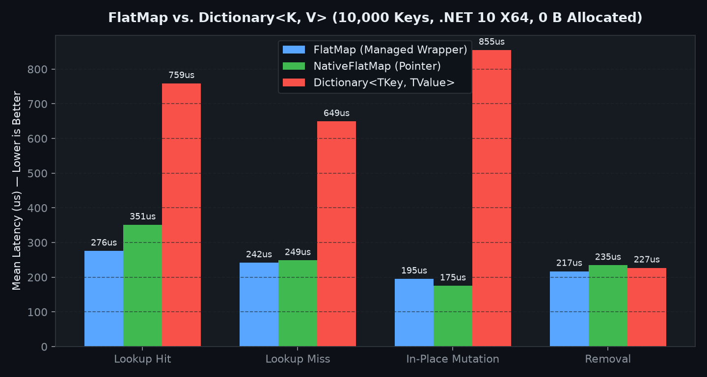

# Benchmark Results

Measured with **BenchmarkDotNet v0.15.8** on `.NET 10.0.2` (`X64 RyuJIT x86-64-v4`, `Job=ShortRun`, `[MemoryDiagnoser]`).  
Reproduce locally:

```bash
dotnet run --project benchmark/Memory.Benchmark -c Release -- --filter "*SpscRingBenchmark*" "*UnmanagedLinearArenaBenchmark*" "*FlatMapBenchmark*"
```

---

## 1. `FlatMap` / `NativeFlatMap` vs. `Dictionary<TKey, TValue>`



* **Takeaway:** On `10,000` and `100,000` unmanaged keys, `FlatMap` / `NativeFlatMap` is **~2.7× to 4.9× faster** on hits, misses, and in-place mutations with **0 B** managed allocation.
* **Honest Trade-Off:** Dense `Full_Table_Iteration` is faster on `Dictionary<TKey, TValue>` (`335.78 µs` vs `1,554.00 µs` at `100,000` keys) because `Dictionary` iterates a compact `_entries` array while open-addressed `FlatMap` scans sparse table slots.

### `10,000` Keys (ShortRun)
| Method | Mean | Median | Ratio | Allocated |
| :--- | ---: | ---: | ---: | ---: |
| `Lookup_Hit_FlatMap` | **276.00 µs** | 253.93 µs | 1.03 | **0 B** |
| `Lookup_Hit_NativeFlatMap` | 351.31 µs | 290.98 µs | 1.31 | **0 B** |
| `Lookup_Hit_ManagedDictionary` | 758.90 µs | 747.91 µs | 2.82 | 0 B |
| `Lookup_Miss_FlatMap` | **242.10 µs** | 246.76 µs | 0.90 | **0 B** |
| `Lookup_Miss_ManagedDictionary` | 649.28 µs | 635.17 µs | 2.42 | 0 B |
| `InPlace_Mutation_NativeFlatMap` | **175.31 µs** | 180.14 µs | 0.65 | **0 B** |
| `InPlace_Mutation_ManagedDictionary` | 855.14 µs | 860.67 µs | 3.18 | 0 B |
| `BackwardShift_Removal_FlatMap` | **217.31 µs** | 217.96 µs | 0.81 | **0 B** |
| `Removal_ManagedDictionary` | 227.23 µs | 237.80 µs | 0.85 | 0 B |

### `100,000` Keys (ShortRun)
| Method | Mean | Median | Ratio | Allocated |
| :--- | ---: | ---: | ---: | ---: |
| `Lookup_Hit_NativeFlatMap` | **2,408.23 µs** | 2,463.86 µs | 0.83 | **0 B** |
| `Lookup_Hit_ManagedDictionary` | 8,410.68 µs | 8,551.76 µs | 2.88 | 0 B |
| `InPlace_Mutation_NativeFlatMap` | **2,596.68 µs** | 2,592.78 µs | 0.89 | **0 B** |
| `InPlace_Mutation_ManagedDictionary` | 8,471.03 µs | 8,354.50 µs | 2.90 | 0 B |

---

## 2. `UnmanagedLinearArena`

| Method | LeaseCount | Mean | Median | Allocated |
| :--- | ---: | ---: | ---: | ---: |
| `Lease_Batch_Slices` | 100 | **122.7 ns** | 126.0 ns | **0 B** |
| `Lease_Batch_Slices` | 1,000 | **538.3 ns** | 539.0 ns | **0 B** |
| `Lease_Batch_Slices` | 10,000 | **4,101.2 ns** | 4,172.5 ns | **0 B** |
| `Lease_SingleThreaded_Cycle` | 10,000 | 157,031.7 ns | 153,485.0 ns | **0 B** |

---

## 3. `SpscRing`

| Method | Mean | Allocated |
| :--- | ---: | ---: |
| `RoundTrip_ZeroCopyPointer_64B` | **269.8 ns** | **0 B** |
| `RoundTrip_Copy_512B` | **280.2 ns** | **0 B** |
| `Batch_BulkEnqueue_And_Drain_64B` | **1,869.2 ns** | **0 B** |
| `Batch_ScalarEnqueue_And_Drain_64B` | 3,722.0 ns | **0 B** |
